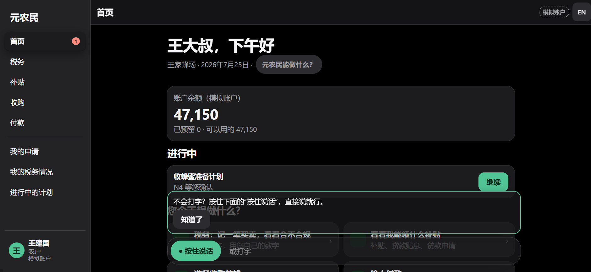
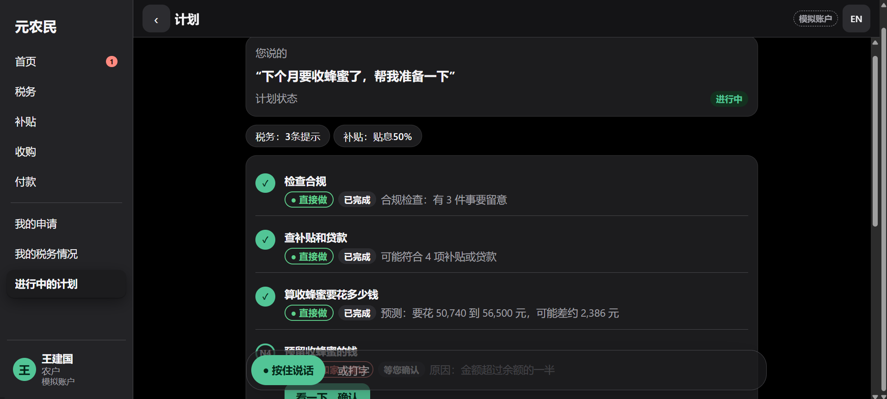
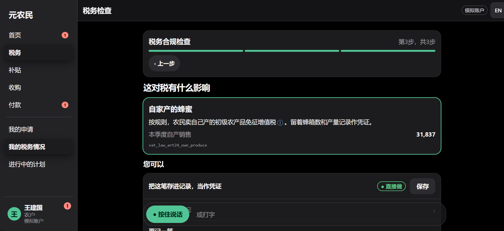
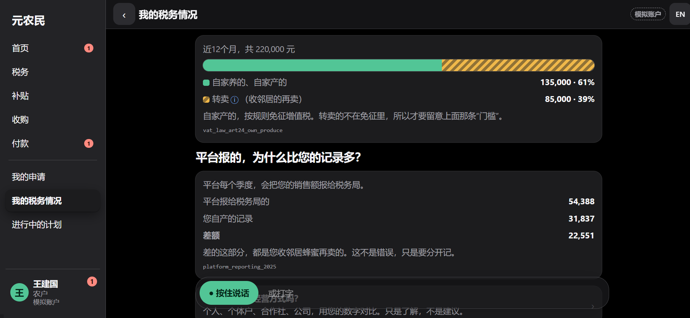
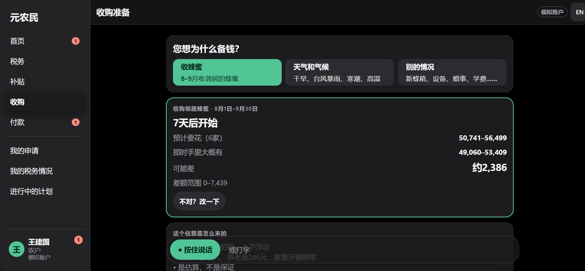
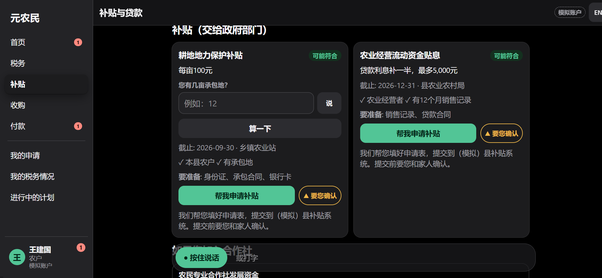
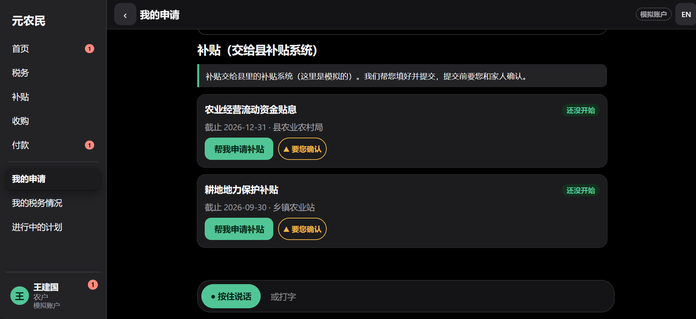
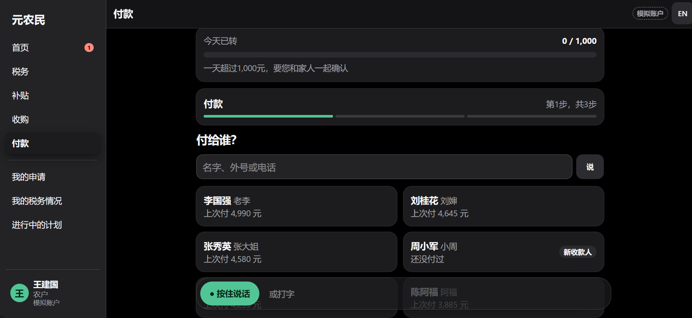
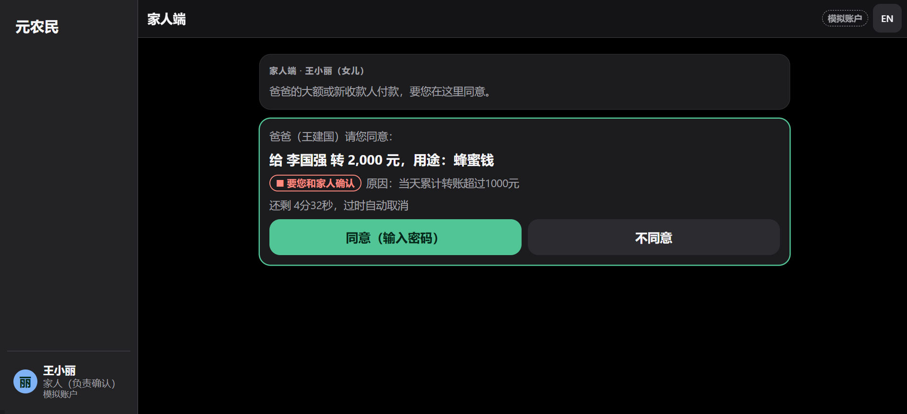

# We-Agri-Copilot 元农民

**Live demo:** https://we-agri-copilot.onrender.com/ (farmer `/`, family `/family`, judge panel `/judge`)

- Free hosting: the first load may take up to a minute (the instance sleeps when idle).
- It may be slow or unreachable from mainland China. **The demo video is the primary demo:** VIDEO_LINK
- Simulated accounts, synthetic data. Demo PINs: `123456` (farmer, Uncle Wang) and `654321` (daughter, co-signer).
- Use 重置演示 (judge panel, 演示工具) to start over.

A voice-first banking agent that does the back office for small agricultural businesses in China selling online, designed for older,
low-literacy owners. WeBank FinTechathon 2026, Topic E (SME Finance Copilot).

The demo is the **website** (`web/`): screens and buttons first, with voice as a helper, in Chinese and English. The **WeChat Mini Program**
(`miniprogram/`) is the production channel on the roadmap; its code is kept, but it is not needed to run or demo the website.
Documentation: [Technical documentation](docs/TECHNICAL_DOCUMENTATION.md) · [Security self-assessment](docs/SECURITY_SELF_ASSESSMENT.md) ·
[Project report](docs/full-project-report.md) · [Build plan](docs/build-plan.md) · [Execution evidence](docs/Execution_evidence.md) ·
[Demo script](docs/Demo_script.md) · [Forecast backtest evidence](evidence/backtest_forecast.md).

> **SIMULATED ACCOUNTS — synthetic data only.** The bank is "Mock Bank — simulated accounts". Uncle Wang and
> Wang Family Apiary are fictional. The county policy table is simulated.
>
> **Information, not tax advice.** The app shows cited rules and numbers from the user's own sales record.
> It never recommends a tax structure, never files anything, and points to 12366.

Three features run on one **sales record** (platform orders matched to bank payouts, tagged
own_produce / resale / processed):

1. Tax structure comparison + compliance check (cited information)
2. Subsidy & loan matching (one simulated county, "may qualify" wording)
3. Pre-procurement forecast + cash gap + plan (reserve, supplier payments, financing)

Chained request (S6): "下个月要收蜂蜜了，帮我准备一下" → task DAG with interrupt and partial rollback.

## Screenshots

| Screen | What it shows |
|---|---|
|  | Home: balance, the plan in progress, and what the farmer can ask |
|  | One sentence ("下个月要收蜂蜜了，帮我准备一下") becomes a step-by-step plan; risky steps wait for confirmation |
|  | Tax compliance check: own produce vs resale, with the rule cited |
|  | Tax overview: 61% own produce / 39% resale, and why the platform figure is higher |
|  | Purchase forecast: spend and cash as ranges, with the likely gap |
|  | Subsidies and loans the business may qualify for, with documents and deadlines |
|  | Applications: drafts prepared, submission needs the farmer's and family's confirmation |
|  | Payments: daily 1,000 CNY limit, known payees, a new payee flagged |
|  | Family view (daughter's phone): approve or decline a risky payment, with the reason and a time limit |

## Architecture

```
web/ (Vite, React)  ───HTTP──> FastAPI  (the website is served by the backend in the Docker image; its calls go to /api)
miniprogram/ (Taro, roadmap channel: same API)
                                  ├─ /bank/*   mock bank (SQLite): balance, payees, transfers, reserves,
                                  │            order import, PIN/MFA, co-signer approvals, safety lock
                                  ├─ app/risk  deterministic tier engine (green/yellow/red, only ever raises)
                                  ├─ app/audit SHA-256 hash-chained, append-only audit log, trace view
                                  ├─ app/analysis, app/agent, app/llm, app/voice   (sales record, compliance, forecast,
                                  │            policy match, planner + executor, Qwen/Groq client, ASR/TTS)
                                  └─ rule_tax / rule_policy tables (seed JSON, PRC rules only)
```

Principle: **LLMs plan and explain; deterministic code computes.** The LLM never decides tiers, amounts, tax
results or payees. Non-green bank actions return `202` + an approval; they execute only with a single-use token
bound to that exact request (PIN, plus co-signer when the customer has protection mode and the tier is red).

## Live demo (Render)

The Docker image at the repo root serves the website and the API from one URL (`/api/...`; the old paths still work for the Mini Program).

Deploy: push the repo to GitHub, in Render choose **New > Blueprint**, pick the repo (it reads `render.yaml`: one free web service, Singapore),
then fill in the environment variables in the dashboard: `LLM_PROVIDER=groq`, `GROQ_API_KEY`, `GROQ_PLANNER`, `GROQ_CLASSIFIER`, `GROQ_ASR`,
`LLM_MOCK=0`, `DEMO_PUBLIC=1`, `DEMO_TODAY=2026-07-25`. Check `https://<your-service>.onrender.com/health`.

With `DEMO_PUBLIC=1` the service shows a "演示环境 · 模拟账户 · 数据会重置" banner, turns off `/docs` and CORS, allows `POST /demo/reset`, and limits paid model
calls (20 per minute per IP, 500 per day; past that, answers come from fixed templates). The database is rebuilt on every start.

Things to know:
- The free instance sleeps when idle: the first load after a pause takes about a minute.
- The site can be slow or unreachable from mainland China. **The video is the primary demo**; the live link is a backup for judges outside China.
- Run locally with no key: `LLM_MOCK=1`. Easiest: `web.bat` (see Quick start). By hand: backend `cd backend && python -m seed.seed && uvicorn app.main:app`,
  website `cd web && npm run dev`, or build it with `npm run build` and the backend serves it at http://localhost:8000.
  Or `docker build -t wac . && docker run -p 8000:8000 -e LLM_MOCK=1 wac`.

## Quick start (Windows)

Double-click, or run from a terminal in the repo folder (paths with spaces are fine). Needs Python 3.12 (`py -3.12`) and Node 20.

1. `setup.bat` once: creates `backend\.venv` and installs the backend packages (it also installs the Mini Program's npm packages, which the website does not need), and copies `.env.example` to `.env` if there is none.
2. Open `.env` in Notepad and add your keys (`LLM_MOCK=1` needs none).
3. `web.bat`: opens two windows, the backend (reseeds `data/app.db`, then uvicorn on port 8000) and the website (`npm run dev`; the script runs `npm install` in `web/` first if the packages are missing).
4. Open http://localhost:5173 (farmer). Open http://localhost:5173/family in a second window for the daughter, and http://localhost:5173/judge for the judge panel.

| Script | What it does |
|---|---|
| `setup.bat` | One time: Python venv, backend packages, `.env` from the example. |
| `web.bat` | Starts the backend and the website, each in its own window. |
| `test.bat` | pytest with `LLM_MOCK=1`, audit-chain verify, `smoke_llm.py --dry`, then a PASS/FAIL summary. |
| `start.bat`, `phone.bat`, `h5.bat` | Mini Program only (WeChat build, real-phone address, browser preview of the Mini Program). Not needed for the website. |

If the backend is not running, the website still opens and works on built-in sample data (nothing then touches the bank). To start over during a demo use the judge panel (`/judge` → Scenario controls → Reset data).

## Run the website

```bash
cd web
npm install
npm run dev        # http://localhost:5173 (also on your LAN address)
npm run build      # typecheck + production build
```

In development Vite forwards `/api` to the backend on `http://localhost:8000`, so the browser needs no CORS setting. For a build served from
somewhere else, set `VITE_API_BASE`. When the site opens it asks the backend `/health`: backend up means the money actions, the plan, the judge panel and
hold-to-talk use the real endpoints; backend down means the built-in sample data.

**Live (real endpoints):** payments (transfer, confirm, PIN, co-sign, execute), the tax-pot rule, loan draft / submit / withdraw, the honey-season plan and the
pay-six-families plan with the five commands, balance / reserved / lock, and the judge panel (trace, audit check, scenario controls). Hold-to-talk needs a
speech provider; without one it offers the stand-in sentence.
**Still sample data:** the forecast, policy, compliance and tax numbers on the screens, the climate and cash plans, a payee typed in by hand, the loan review
states, and English wording of the agent's replies (Chinese only for now). Spoken replies are not wired.

| Route | What |
|---|---|
| `/welcome`, `/` | first visit; task-first home |
| `/tax/check`, `/tax` | guided tax check; my tax situation |
| `/support`, `/applications` | subsidies and loans; application status |
| `/season`, `/plan` | buying-season forecast; the agent's plan (approve, pause, "not the loan", "never mind") |
| `/pay` | guided payment |
| `/family` | the daughter's window (a second window of the same browser) |
| `/judge` | judge panel: trace, audit check, scenario controls |

Test PINs on the simulated account: Uncle Wang `123456`, daughter `654321`. The farmer and family windows must be two windows of the same browser (same profile): the daughter's request is passed through the browser's saved
state, so a separate phone or another browser does not see it yet.

## Run the backend

**Use Python 3.12; 3.13+ is not supported yet (pydantic-core / LangGraph wheels).** Supported range:
`>=3.11,<3.13` (no `pyproject.toml`, so this is documented here; `backend/.python-version` pins 3.12).

Windows (PowerShell):

```powershell
cd backend
py -3.12 -m venv .venv
.venv\Scripts\activate
pip install -r requirements.txt
```

Or without activating, on any OS:

```bash
cd backend
python -m venv .venv
.venv/Scripts/python -m pip install -r requirements.txt   # Linux/macOS: .venv/bin/python
.venv/Scripts/python -m seed.seed                          # builds data/app.db (idempotent: rebuilds everything)
.venv/Scripts/python -m uvicorn app.main:app --reload      # http://127.0.0.1:8000/docs
.venv/Scripts/python -m pytest -q
.venv/Scripts/python -m app.audit.verify                   # check the audit hash chain
```

With GNU make: `make install seed dev test verify-audit`. Docker: `docker compose up --build` (seed once with
`docker compose run --rm backend python -m seed.seed`). Copy `.env.example` to `.env` for the Qwen key
(`LLM_MOCK=1` needs no key).

Demo logins (synthetic): Uncle Wang = customer 1, PIN `123456`, protection mode on. Daughter/co-signer =
customer 2, PIN `654321`. Seeded window is 2025-07 to 2026-06 (demo "today" ≈ July 2026).
Demo clock: all date logic uses `app.clock.today()`, which is `DEMO_TODAY` (default `2026-07-25`, so the honey purchase is
about 3 weeks away); set `DEMO_TODAY=` empty for the real date. Re-run `python -m seed.seed` after changing it.
Backtest of the forecast: `python -m scripts.backtest_forecast` (writes `evidence/backtest_forecast.md`).
Execution evidence: `make evidence` replays the scripted runs and writes `evidence/runs/*.jsonl` (see [docs/Execution_evidence.md](docs/Execution_evidence.md)).
Sample order exports for `POST /bank/orders/import` are in `backend/seed/orders/`.

## WeChat Mini Program (roadmap channel, not needed for the demo)

The Taro Mini Program in `miniprogram/` is kept for the production path. Build and run it only if you work on it:

```bash
cd miniprogram
nvm use 20                # Node 20 LTS recommended (engines: >=18 <21)
cp .env.example .env     # optional: TARO_APP_API_BASE_URL (default http://localhost:8000)
npm install
npm run dev:weapp         # or `start.bat`, then open miniprogram/ in WeChat DevTools (AppID: touristappid)
```

The API base URL is a build-time constant (`TARO_APP_API_BASE_URL`, default `http://localhost:8000`; use the PC's LAN IP for a real phone and rebuild,
or run `phone.bat`). In WeChat DevTools untick "不校验合法域名…" (Details → Local settings) so it can call `http://127.0.0.1:8000`.
`npm run dev:h5` (or `h5.bat`) builds the same Mini Program UI for a browser; the backend allows cross-origin calls from localhost and private-LAN
addresses on port 10086 (add others with `CORS_ORIGINS`). The Mini Program is not run in Docker.

### Mini Program design tokens

All styling reads `miniprogram/src/styles/tokens.scss` (CSS variables on `page`). Nothing else hard-codes a size, colour or timing.

- **Type:** system font stack; scale small 18px / body 20px / title 26px / figure 28px / number 36px, with size-specific
  tracking (large text slightly negative, body 0) and inverse leading. Floors for older users: text >= 18px, key numbers >= 28px.
- **Space and shape:** spacing `--sp-1..6` and radii `--r-*` in rpx (8px grid); tap targets `--tap-min` = 48px.
- **Colour:** one calm accent. Tiers are shape + word + colour, never colour alone: ● 直接做 / ▲ 要您确认 / ■ 要您和家人确认.
- **Motion:** transform + opacity only, one curve (`--ease`, no overshoot), 300ms enter/leave, 100ms press feedback.
  Cards enter from the side of their trigger and leave the same way. `reducedMotion` (`utils/settings.ts`, default off,
  toggle at the bottom of the chat page) swaps slides for a 150ms cross-fade.
- **Chrome:** the header and bottom bar are solid white with a 1px hairline: no blur, no gradients. Demo-only controls sit in a quiet "演示工具" block at the very bottom of the chat page.

## Models: Qwen (production) and Groq (demo stand-in)

Chat (planner, spoken explanations, injection classifier) and speech-to-text go through one OpenAI-compatible client. Pick the
provider with `LLM_PROVIDER` in the repo-root `.env`, set that provider's key, and set `LLM_MOCK=0`:

| | `dashscope` (default) | `groq` |
|---|---|---|
| keys / URL | `DASHSCOPE_API_KEY`, `DASHSCOPE_BASE_URL` | `GROQ_API_KEY`, `GROQ_BASE_URL` |
| chat models | `QWEN_PLANNER` (qwen-plus), `QWEN_CLASSIFIER` (qwen-flash) | `GROQ_PLANNER`, `GROQ_CLASSIFIER` |
| speech-to-text | `QWEN_ASR` (qwen-audio-3.0-asr-flash), payee names as context | `GROQ_ASR` (Whisper), language zh, payee names as the prompt |
| text-to-speech | `QWEN_TTS`, every clip starts with 元农民助手： | none: `/voice/tts` answers 204 and the app shows the reply as large text labelled 元农民助手（人工智能） |

A key is only ever sent to its own provider. Everything else is identical on both: the DAG schema and tool allow-lists, the grounding
and wording checks, the injection rules, the 10 s timeout, and the template fallback when a model fails. With `LLM_MOCK=1` (or no key)
nothing leaves the machine and every feature uses its template. The tests always run offline.

**Production uses Qwen** (its speech models are the ones built for dialect and elderly speech). **The demo build may use the Groq
stand-in** while the Alibaba account is being verified; Whisper is weaker on dialect and quiet or slow speech, so expect more
"请确认" read-backs there.

**Local Qwen with Ollama (no key, free)** is a third option, `LLM_PROVIDER=ollama` (default model `qwen2.5:7b` after `ollama pull qwen2.5:7b`; set
`LLM_MOCK=0` and `LLM_TIMEOUT=60` or more, because a local model is slower). It has no speech: `/voice/asr` answers 503 and `/voice/tts` answers 204, so the app
asks for typing. We used it for the live-model evidence runs (`make evidence-live`); the live demo runs on Groq.

`python scripts\smoke_llm.py` (from `backend/`; `--dry` shows the configuration without calling anything) calls each model of the
selected provider once, prints OK/FAIL/SKIP with the latency, lists the provider's models and WARNs about a configured id that is not
in the list. `smoke_qwen.py` is kept as an alias.

## Status

Matches [docs/SECURITY_SELF_ASSESSMENT.md](docs/SECURITY_SELF_ASSESSMENT.md) (status words are used strictly: Implemented = code plus a test).
`LLM_MOCK=1 pytest -q`: **261 tests pass** (the self-assessment was written at 239).

**Implemented**
- Permission tiers and raise rules (new payee, 2x median, over half the balance, night time, daily 1,000 CNY); the tier only ever goes up.
- Typed 6-digit PIN (salted PBKDF2), family co-signer on its own phone, single-use approval tokens bound to the exact request, 5-minute expiry.
- Safety lock (3 wrong PINs, injection detected, manual); locked = reads work, money cannot move; unlock always needs the co-signer.
- Prompt-injection defence: untrusted-text wrapper, rule and model score, lock on detection, no payees or amounts from model text.
- Grounding and wording checkers on model replies and tax/policy output (no advice, no filing words).
- Hash-chained audit log with trace ids, verify command and endpoint, masked trace view.
- Mock bank, sales record and reconciliation, compliance check, structure comparison, policy matching, procurement forecast, plan DAG with
  approval, pause, partial rollback and human handover; Qwen/Groq provider switch with offline template fallback.
- Website pages (farmer, family co-signer, judge trace) wired to the backend, with a fall-back to sample data when it is down; the Mini Program pages exist but are not part of the demo.
- Execution evidence: `make evidence` exports 15 reproducible runs (E02, E04-E16 and a tamper check) with their hash-chained audit rows; `make evidence-live` exports 5 runs with a real model.

**Partial**
- Speech-recognition guard: a heuristic read-back for doubtful audio; no list of known silence hallucinations.
- AI labelling: spoken and on-screen label; no machine-readable audio metadata.
- Personal data: synthetic only; no consent screen, no encryption at rest.
- Injection scan covers order notes and product titles only.
- Rule citations: every `citation_url` is still `"TODO"` and six tax rules are `recall` (shown as 待核实). No URL has been invented.
- Website: some screens (forecast, policy, compliance and tax numbers) still show sample numbers; see "Run the website" for what is live.
- Model quality is only tested with fakes; the demo may run on a Groq stand-in instead of Qwen.

**Not implemented**
- Device binding and spoken PIN; anomaly detection and an anomaly-triggered lock.
- Proactive triggers, automatic handover after failed clarifications, tax-text explainer.
- Real bank or platform APIs, a real AppID and ICP-filed domain, generative-AI service registration, audio watermark.
- Detection of a deleted audit-log tail (tamper-evident, not tamper-proof).

**Dropped from the scope:** sandboxed code execution for open-ended questions (E3) and the monthly spending report (E1).
