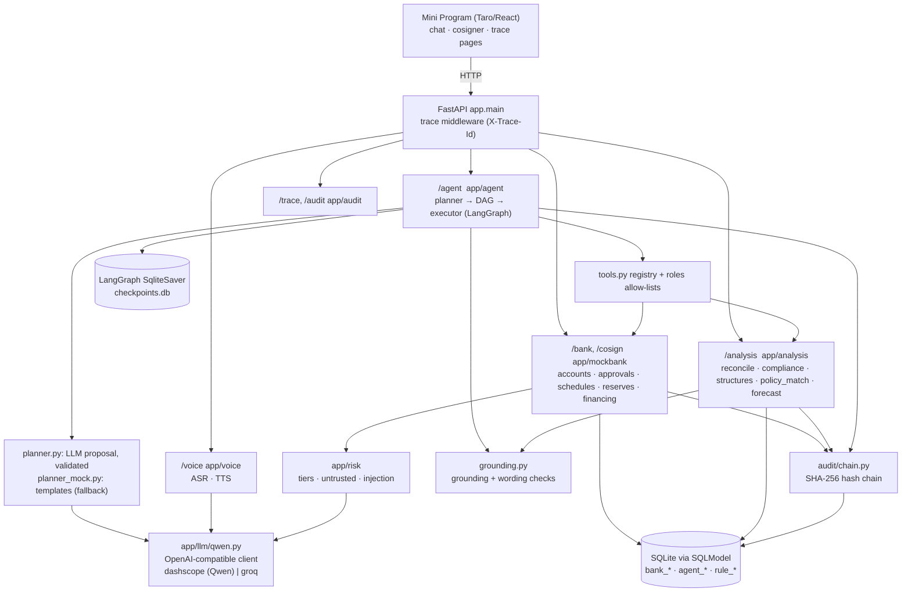

# We-Agri-Copilot 元农民 — Technical Documentation

WeBank FinTechathon 2026, Topic E (SME Finance Copilot). This document describes what is **implemented in this repository**. Where the project report (`docs/full-project-report.md`) or build plan (`docs/build-plan.md`) says something the code does not do, it is listed in [section 9](#9-differences-between-the-plan-and-the-code).

> **Simulated accounts, synthetic data only.** The bank is "Mock Bank — simulated accounts". Uncle Wang and Wang Family Apiary are fictional. The county policy table is simulated. Nothing here is tax or financial advice.

## 1. Overview and problem

Agricultural trade in China is moving online, but the people left to run small agri-businesses are increasingly older and less literate. Platforms teach them to list and livestream; nobody does their back office: whether their set-up fits what they sell (own produce is VAT-exempt, resold produce is not), which subsidies and cheap loans they may qualify for, and whether the cash will be there for the next buying season.

We-Agri-Copilot is a voice-first banking agent (WeChat Mini Program) for these owners. Three features run on one **sales record** (platform orders matched to bank payouts and tagged own produce / resale / processed): (1) tax-structure comparison and compliance check, (2) subsidy and loan matching, (3) pre-procurement forecast with a cash gap and a plan. They chain into one request, "下个月要收蜂蜜了，帮我准备一下" (scenario S6), executed as a task DAG with approvals, pause, partial rollback and human handover. Design principle: **LLMs plan and explain; deterministic code computes.** The model never decides a tier, an amount, a tax result or a payee.

## 2. Architecture



Everything runs in one FastAPI process. The agent calls the same bank functions the Mini Program's HTTP endpoints use (in-process, not over HTTP), so tier rules, token checks and audit rows are the real ones.

### Components

| Component | Files | What it does |
|---|---|---|
| App entry, trace middleware | `backend/app/main.py`, `app/trace.py` | Mounts routers; starts/continues a trace id per request; stamps every audit row with trace id, endpoint and wording-check result |
| Config, demo clock | `app/config.py`, `app/clock.py` | Settings from `.env`; `DEMO_TODAY` (default 2026-07-25) is the one source of "today" |
| Tier engine | `app/risk/tiers.py` | Pure functions: base tier, raise rules, co-signer requirement |
| Untrusted text, injection | `app/risk/untrusted.py`, `app/risk/injection.py` | `Untrusted` wrapper; rule + model injection score |
| Mock bank | `app/mockbank/{router,service,cosign,schedules,rules,financing,plan,numerals,schemas}.py` | Balance, payees, transfers, reserves, schedules, tax-pot rule, loans, approval state machine, PIN, lock, co-signer |
| Analysis | `app/analysis/{reconcile,compliance,structures,policy_match,forecast,history,common,router}.py`, `app/tax/vat.py` | Deterministic sales record, compliance flags, structure table, policy matcher, forecast |
| Agent | `app/agent/{planner,planner_mock,dag,tools,executor,graph,explain,grounding,router}.py`, `app/agent/roles/` | Planner contract, DAG, tool registry, saga executor, LangGraph wiring, replies, checkers |
| LLM and voice | `app/llm/qwen.py`, `app/voice/{asr,tts,router}.py` | Provider switch, JSON chat, ASR with payee glossary, TTS with spoken AI label |
| Audit | `app/audit/{chain,verify,router}.py` | Hash chain, CLI verify, `/trace/*` and `/audit/verify` |
| Data | `app/models/`, `app/db.py`, `backend/seed/` | Tables; seed JSON (tax rules, county policies, product catalog), order CSV samples, Uncle Wang data |
| Mini Program | `miniprogram/src/{pages,components,services,styles}` | Pages: chat, cosigner, trace. Cards: plan, approval, comparison, flags, forecast, support, lock, PIN pad |
| Scripts | `backend/scripts/backtest_forecast.py`, `scripts/smoke_llm.py` | Forecast backtest; one real call to each configured model |

## 3. Core algorithms

### 3.1 DAG planner contract and mock fallback
Files: `app/agent/dag.py`, `planner.py`, `planner_mock.py`, `tools.py`, `roles/`.

- **Schema.** `Dag.nodes[{id, tool, label_zh, args, depends_on, undo, base_tier}]`. Validation rejects duplicate ids, unknown dependencies and cycles (`Dag.order()` is a topological sort). `Dag.digest()` is the SHA-256 of the canonical JSON.
- **Who decides what.** The plan names tools and their order only. `tools.validate` rejects a plan that: uses a tool no role owns; labels a tool lower than its real tier; carries an `undo` that does not match the tool; writes an amount or payee id as a literal where the tool requires a `{"$ref": "N3.reserve_amount"}` from an earlier node (`ref_only`); references a node that is not an ancestor; or contains `Untrusted` text anywhere.
- **Per-role allow-lists** (`agent/roles/`): cashflow (`forecast_procurement`, `plan_supplier_payments`, `reserve_funds`), payments (`resolve_payee`, `transfer_money`, `schedule_conditional_transfers`), risk_policy (`check_compliance`, `match_policies`, `prefill_financing`, `submit_financing`). The planner role owns no tool. A tool outside every list cannot be in a plan.
- **LLM planning** (`planner.plan`): with a model enabled, the model returns JSON. Code accepts it only if node count is 1–10, ids and arg keys are well-formed, labels pass the wording check, and any literal number or name in args was actually said by the user (`_check_literals`). Tier and undo written by the model are **ignored**; the registry fills them in. Bad JSON, an unknown tool or a rule violation triggers **one re-plan** with the error text; then the fixed templates. The model may instead return one clarifying question.
- **Mock/fallback** (`planner_mock.py`): templates for the three known requests (S6 chain N1–N6; "像去年一样给六家付蜂蜜钱"; "给X转N元…"), else one clarifying question. Used when `LLM_MOCK=1`, no key, a model outage, or two rejected attempts. Templates hold no amounts; money comes from `$ref`s.
- **Plan integrity.** `executor.create_plan` stores the DAG with its hash and anchors the hash in an audit row (`agent_plan_created`). `executor.verify` re-checks schema, hash and the audit anchor before every approve/command; a mismatch stops the plan.

### 3.2 Tier engine
File: `app/risk/tiers.py` (`classify`). Pure, no model involved.

- **Base tiers.** Green: reads and analysis. Yellow: reserve, reserve rule, schedule, schedule cancel, financing pre-fill, and a transfer to a known payee. Red: financing submit, unlock, a transfer to a new payee, or a transfer that takes the day's cumulative transfers above 1,000 CNY.
- **Raise rules (yellow → red).** New payee; amount more than 2× the customer's median transfer; amount more than 50% of the balance; night-time (23:00–06:00, time of day is real, date is the demo clock). A payee first paid less than 365 days ago still counts as new (`service.payee_known`).
- **Never lower.** `final >= base` by construction; raise rules only act on yellow; reasons are recorded.
- **Co-signer.** `requires_cosigner = protection_mode and final == red`. Unlock always requires the co-signer.
- Approval flow (`mockbank/service.py`): green runs at once; yellow needs the customer's confirmation of the read-back; red needs confirmation + PIN (+ co-signer in protection mode). Success yields a **single-use token**, bound to `sha256(payer, action, payload)`, valid 5 minutes (details in the security document).

### 3.3 Sales-record reconciliation
File: `app/analysis/reconcile.py`.

1. **Import** (`import_orders`): one adapter per CSV style (`marketplace`, `livestream`) maps to a common schema. Idempotent by order id. Notes and product titles are wrapped as `Untrusted` and scored for injection per new order.
2. **Tag** (`tag`): income class from `seed/product_catalog.json` by substring on the product name (`自家`→own_produce, `邻家`→resale, `白菜`→own_produce, `加工`→processed). No match or conflicting matches → `needs_confirmation`.
3. **Match payouts** (`_match`): a monthly batch match, not per order. Per (platform, month), a payout whose counterparty names that platform, landing between month start and month end + 7 days, with amount 95–100% of that month's gross, is matched. Documented limit: a missing order under ~5% of a month hides inside the tolerance.
4. **Buckets** (`reconcile_range`): each positive order lands in exactly one bucket, first rule wins: needs_confirmation > missed_payout > resale > record. `gap = platform_reported − record_total`, where `record_total` is net of refunds; `gap = resale + refunds + missed_payout + needs_confirmation`.

### 3.4 Compliance rules engine and the VAT threshold
Files: `app/analysis/compliance.py`, `app/tax/vat.py`, `seed/rules_tax.json`.

Flags: `RESALE_SHARE` (last 12 months), `RECONCILIATION_GAP` (selected quarter), `VAT_THRESHOLD`, and `NEEDS_CONFIRMATION` when products are untagged. Numbers come from code; thresholds come **only from `rule_tax` rows** (`load_rules`; a missing row raises). Flag text cites rule ids.

**VAT boundary** (`vat_due`, rule `vat_ann2026_no10_threshold`, month 100,000 / quarter 300,000 / occasion 1,000, levy 1%): own produce is always exempt; for other sales, `sales < limit` → exempt, `sales >= limit` → **the full amount is taxable** (`taxable_base = sales`). Not a marginal tax on the excess. `tests/test_vat.py` covers the month, quarter and occasion boundaries. The flag also reports whether the rule is in its effective period.

### 3.5 Structure comparison
File: `app/analysis/structures.py`. A fixed table, identical for every user: rows VAT / income tax / paperwork × columns A individual, B 个体工商户, C cooperative, D company; the user's numbers are filled in. A cell citing any rule whose status is not `verified` renders as `待核实` with no value. There is no "best" field and no recommendation. Income-tax cells for A and C are intentionally empty (placeholder rules). Estimates (VAT, taxable income, small-low-profit EIT) state their assumptions.

### 3.6 Policy matcher
File: `app/analysis/policy_match.py`. Deterministic, against the single **simulated** county table.

- `build_profile` merges declared facts (`bank_customer.profile`) with numbers from the sales record (income by class, operating months, financing need = forecast gap upper bound rounded up to 100).
- `evaluate` checks region, deadline and each eligibility key (`entity`, `min_members`, `sector`, `land_use`, `min_cultivated_mu`, `loan_purpose`, `min_operating_months`, `max_amount`). **An unknown rule key or unknown fact counts as not met.**
- Groups: `may_qualify` (nothing unmet; an assertion guards this), `if_you` (only structural rules unmet: "if you joined a cooperative…"), `not_eligible` (kept with reasons). Wording is always "可能符合" ("may qualify"). Items whose `last_checked` is older than 180 days are flagged `needs_verification`.
- Financing (`mockbank/financing.py`): every product's **full cost** (interest + fees, simple interest to maturity) is shown; if an interest-subsidy policy may apply, the cost after subsidy is shown **next to** it (subsidy = min(interest × rate, cap)). Pre-fill builds a draft from the sales record (yellow); submit is red and goes only to the Mock Bank.

### 3.7 Procurement forecast
File: `app/analysis/forecast.py` (+ `history.py`). Deterministic; returns ranges and assumptions, never one number.

- **Window.** The next calendar window starting within 60 days. Purchases per supplier come from the same window in the previous 1–3 years: range = payments per season × min/max single payment.
- **Cash at window start** = available balance (balance − active reserves) + expected inflows (recurring pension; platform payouts at month end, net of the trailing 12-month fee ratio; this month's run-rate or same month last year) − recurring outflows seen in ≥10 of the last 12 months − already scheduled payments. Reported as low/high.
- **Gap.** `gap_low = max(0, need_low − cash_high)`, `gap_high = max(0, need_high − cash_low)`, plus an expected value from midpoints. For Uncle Wang the seeded gap is about 2,400 (seed calibrated with `HOUSEHOLD` and `CUSHION`; asserted in `tests/test_forecast.py`).
- **Plan.** Suggested steps (reserve rounded up but capped at free funds; loan pre-fill and submit; supplier payments on delivery), each carrying the tier the tier engine would give it. Nothing is executed.
- **Backtest** (`scripts/backtest_forecast.py` → `evidence/backtest_forecast.md`): 5 synthetic households; actual inside the forecast range in 3 of 5; mean absolute error of the midpoint 7.1%; 1 household with a real shortfall, warned ≥7 days ahead; 2 warned although cash proved enough. The households are generated from assumptions similar to the forecaster's, so this shows the mechanics, **not accuracy on real farms**.

### 3.8 Rollback (saga) and orchestration
Files: `app/agent/executor.py`, `graph.py`.

- One LangGraph node per DAG node, in dependency order, `SqliteSaver` checkpointer. A write node first opens a **real bank approval** (read-back → confirm → PIN → co-sign), then calls `interrupt()`; `/agent/approve` resumes with `Command(resume=token)`. The bank re-checks the token before the plan moves.
- The authoritative plan state lives in `agent_plan.state` (not the checkpoint), so commands never edit a checkpoint.
- **Commands:** 等一下 (pause), 继续 (resume), 贷款先不要 (undo only the financing branch: financing nodes plus nodes that depend only on them; the reserve stays), 算了 (undo every completed node, newest first; pending approvals are revoked), 找人工 (handover record with DAG, state and trace id).
- **Compensations** (`tools.UNDO`): release reserve, withdraw application (draft or submitted), cancel schedule batch. A direct transfer has no undo ("money that has left cannot be called back"); `算了` reports it as not undoable rather than hiding it.
- A failed node stops the plan (`failed`); the user can still say 算了 or 找人工.

### 3.9 Grounding and wording checks
File: `app/agent/grounding.py`.

- **Grounding** (`check_grounding`): every number in a reply (small whole numbers ≤10 excepted) and every known payee/product name must appear in this turn's tool outputs. Chinese numerals are converted (`zh_to_number`). Applied to **model rephrases** in `explain.speak`: a failing rephrase is regenerated once, then replaced by the deterministic template. Template replies are code-generated and are not re-checked. The exact bank read-back (digits and numerals) is appended verbatim and never rephrased. Limit: it cannot catch an invented name that is in no list.
- **Wording** (`check_wording`): rejects advice (`你应该/您应该/建议你/建议您`), exemption claims (`免税`, and `免征`/`不用交税` in a "you…" claim), and filing words (`申报/报税/汇算/代办/代为/提交/filing`). `assert_wording` runs on all feature-① output, the forecast text, policy matches, financing texts and planner labels; the pass is recorded in the audit rows of the request (`wording_check`). Strict by design: a false positive means rewording a rule-style sentence.

## 4. Data model

SQLModel tables (SQLite), created by `init_db`. Money is `float` CNY rounded to 2 decimals (a documented simplification for a simulated ledger).

| Group | Tables |
|---|---|
| Bank (`app/models/bank.py`) | `bank_customer` (pin_hash, protection_mode, cosigner_id, failed_pins, locked, lock_reason, profile JSON), `bank_account`, `bank_payee` (aliases, first_paid_at), `bank_txn` (channel, category, income_class, note_untrusted), `platform_order` (buyer_note_untrusted, note_score), `bank_reserve`, `bank_reserve_rule`, `bank_schedule`, `bank_product`, `bank_approval` (action_hash, tier_base/tier, requires_cosigner, confirmed, pin_ok, cosign, status, token, token_at, trace_id), `cosign_request`, `financing_application` |
| Agent (`models/agent.py`) | `agent_plan` (dag_json with hash, state, status), `agent_audit` (prev_hash, hash, ts, actor, event, payload JSON), `agent_handover` |
| Rules (`models/rules.py`) | `rule_tax` (scope, applies_to, rate_or_threshold, effective dates, citation_url, status verified/recall), `rule_policy` (eligibility, benefit, benefit_params, documents, deadline, last_checked, simulated, where_to_go), `calendar` (purchase windows) |

Seed (`python -m seed.seed`, idempotent, fixed RNG): 12 months (2025-07 to 2026-06) for Wang Family Apiary; two platforms; six honey suppliers (one new this year); 16 tax rules; 5 county policies; 2 mock loan products; a planted injection note; planted duplicate charge and night payment. The seed also writes the first audit row.

## 5. API

Interactive docs at `/docs`. `X-Trace-Id` is accepted (validated) and returned on every response.

| Prefix | Endpoint | Tier / note |
|---|---|---|
| — | `GET /health` | |
| `/bank` | `GET /balance`, `/transactions`, `/payees?q=`, `/payouts` | 🟢 |
| `/bank` | `POST /transfers/readback`, `/transfers/plan` | 🟢 template read-back; plan only |
| `/bank` | `POST /transfers` | 🟡 known payee ≤1,000/day; 🔴 new payee, over limit, or raised; 202 + approval without token |
| `/bank` | `POST /reserves`, `DELETE /reserves/{id}` | 🟡 create; delete is an undo (no gate, audited) |
| `/bank` | `POST /reserves/rules`, `GET /reserves/rules`, `DELETE /reserves/rules/{id}` | 🟡 create (tax-pot rule, 1% default) |
| `/bank` | `POST /schedules`, `DELETE /schedules/{batch_id}` | 🟡/🔴 (batch, no money moves); delete is an undo |
| `/bank` | `GET /products/financing?amount=` | 🟢 full cost + subsidised cost |
| `/bank` | `POST /financing/applications`, `GET/DELETE /financing/applications/{id}`, `POST …/{id}/submit` | 🟡 draft; 🔴 submit; delete = withdraw |
| `/bank` | `POST /orders/import?platform=`, `GET /income/statement`, `GET /income/reconcile` | 🟢 (import not gated, injection-scanned) |
| `/bank` | `GET /approvals/{id}`, `POST …/confirm`, `…/cancel` | approval flow |
| `/bank` | `POST /auth/mfa/challenge`, `/auth/mfa/verify` | PIN step for 🔴 |
| `/bank` | `POST /security/lock`, `GET /security/status`, `POST /security/unlock` | unlock is 🔴 and always needs the co-signer |
| `/bank` | `POST /demo/payouts`, `/demo/orders/import-sample` | demo helpers (simulate a payout / import the sample CSV) |
| `/cosign` | `GET /pending`, `POST /{id}/approve`, `POST /{id}/decline` | co-signer's own PIN to approve; decline needs none |
| `/analysis` | `POST /compliance`, `/structures`, `/procurement-forecast`, `/policy-match` | 🟢, information only |
| `/agent` | `POST /message`, `/approve`, `/command`; `GET /session/{id}` | planner + executor |
| `/voice` | `POST /asr` (raw audio body), `POST /tts`, `GET /audio/{name}` | `/tts` answers 204 on Groq |
| `/trace` | `GET /recent`, `GET /{trace_id}` | judge console, account digits masked |
| `/audit` | `GET /verify` | hash-chain check |

## 6. Model and provider configuration

**Production target: Qwen (Alibaba Cloud Model Studio / DashScope).** Chosen because its speech models are built for Chinese dialect and elderly speech (the project report cites the Qwen3-ASR report for this; we have not re-measured it). Defaults in `app/config.py`: planner `qwen-plus`, classifier `qwen-flash`, ASR `qwen-audio-3.0-asr-flash`, TTS `qwen3-tts-flash` (voice `Cherry`), base URL `dashscope-intl`.

**Demo build: Groq stand-in, stated plainly.** Alibaba Cloud account verification was still pending, and the DashScope key we have authenticates but every model call returned `403 AccessDenied.Unpurchased`. The demo therefore uses an OpenAI-compatible stand-in: `LLM_PROVIDER=groq` with planner `openai/gpt-oss-120b`, classifier `openai/gpt-oss-20b`, ASR `whisper-large-v3-turbo` (language forced to `zh`, payee names as the prompt). **Groq has no text-to-speech**, so `/voice/tts` returns 204 and the app shows the reply as large text labelled 元农民助手（人工智能）. Whisper is weaker than Qwen on dialect and slow or quiet speech, so expect more "请确认" read-backs in the demo. Nothing else changes: the DAG schema, allow-lists, checkers, injection rules and tiers are identical on both providers. A key is only sent to its own provider.

Behaviour common to both (`app/llm/qwen.py`): 10 s timeout, no retries, errors carry only the exception class and HTTP status (never a URL or key), identical prompts are cached on disk, and on any failure each feature falls back to its deterministic template. `LLM_MOCK=1` (or no key) means no network at all. The ASR models return no confidence score; `confidence` in `/voice/asr` is a heuristic estimate and says so in the response.

Settings (`.env`, see `.env.example`): `LLM_PROVIDER`, `GROQ_*`, `DASHSCOPE_*`, `QWEN_*`, `TTS_VOICE`, `LLM_TIMEOUT`, `LLM_MOCK`, `DEMO_TODAY`. `python scripts/smoke_llm.py` calls each configured model once (`--dry` shows the configuration only).

## 7. How to run and test

Python 3.12 (3.13+ is not supported by the pinned wheels). From `backend/`:

```bash
python -m venv .venv
.venv/Scripts/python -m pip install -r requirements.txt     # Linux/macOS: .venv/bin/python
.venv/Scripts/python -m seed.seed                           # rebuilds data/app.db
.venv/Scripts/python -m uvicorn app.main:app --reload       # http://127.0.0.1:8000/docs
```

Test (offline; an autouse fixture forces mock mode and removes keys):

```bash
LLM_MOCK=1 .venv/Scripts/python -m pytest -q                # 239 tests, about 80 s
.venv/Scripts/python -m app.audit.verify                    # hash chain check on data/app.db
.venv/Scripts/python -m scripts.backtest_forecast           # rewrites evidence/backtest_forecast.md
```

Docker: `docker compose up --build`, seed once with `docker compose run --rm backend python -m seed.seed`. Mini Program: `cd miniprogram && npm install && npm run dev:weapp` (Node 20), open in WeChat DevTools with the placeholder AppID `touristappid`.

**Reproducing evidence.** The scripted runs of the build plan (E1–E16) exist as pytest tests (mapping in the security document), plus the live trace console (`/trace/recent`, `/trace/{id}`, Mini Program trace page) and `/audit/verify`. Seed, RNG and demo clock are fixed, so results repeat. There is **no `make evidence` target and no `evidence/EVIDENCE_INDEX.md` or E*.jsonl export yet**; the only committed evidence file is `evidence/backtest_forecast.md`.

## 8. Limits to keep in mind
- Mock bank only; no real banking, platform, or government interface exists. Nothing is ever filed or submitted outside the mock bank.
- Tax and policy rows are seed data. All `citation_url` values are currently `"TODO"`, and six of the 16 tax rules are `recall` (shown as 待核实).
- Float money; single-process SQLite; the demo clock is global.
- Reconciliation matches payouts per month, not per order.

## 9. Differences between the plan and the code

Compared against `docs/full-project-report.md` (v3) and `docs/build-plan.md`:

| # | Plan says | Code does |
|---|---|---|
| 1 | React + Vite + Tailwind H5 opened in WeChat; Mini Program out of scope | Taro 4 WeChat Mini Program (`miniprogram/`) |
| 2 | Qwen models (qwen3-asr-flash, Qwen TTS) throughout; "why not Claude or Groq" | Qwen is the configured production target, but the demo runs on Groq (no TTS) because DashScope calls return 403; ASR default is now `qwen-audio-3.0-asr-flash` |
| 3 | Code sandbox (Docker, no network) for open-ended questions; run E3 | **Not implemented** (no sandbox code anywhere) |
| 4 | MCP tool layer | A plain Python tool registry (`agent/tools.py`) with per-role allow-lists; no MCP |
| 5 | Device + spoken PIN + co-signer | PIN is typed on an in-app keypad ("until spoken PIN exists"); `device_id` is stored but never checked; co-signer is implemented |
| 6 | Safety lock on 3 bad PINs, injection, **or anomaly score** | Lock triggers: 3 bad PINs, injection flagged in an imported order, manual. `detect_anomalies` is a stub (`NotImplementedError`); the planted duplicate-charge and night-payment rows are never detected |
| 7 | Injection scan on order notes, payee notes, merchant names | Scanned: order notes and product titles at import. Payee notes and bank-transaction notes are stored as untrusted but not scored; payee lookup matches names/aliases only |
| 8 | Human takeover on "get me a person" **or two failed clarifications** | Only on the user's 找人工 command |
| 9 | Proactive triggers (daily cash check, quarterly compliance, deadline check) | Not implemented; everything is request-driven |
| 10 | Tokenised ID/bank details; consent screen; AI label also as metadata | No ID numbers are stored (pre-fill lists them under `needs_from_you`); **no consent screen**; label is spoken text and on-screen text, no audio metadata |
| 11 | Every structure-table cell cites a rule with a link | Cells cite rule ids and status; every `citation_url` is `"TODO"` (no URLs invented) |
| 12 | Tax statement "explain this tax text" (E14 / "这个税务短信什么意思") | No endpoint for explaining a pasted tax text; compliance flags and the gap breakdown exist |
| 13 | Mock API paths like `/accounts/{id}/balance`, `/income/...`, `/rules/tax`, `/policies`, `/split-bills`, `/auth/mfa/*`, `/security/*` | Paths live under `/bank/...`; `/rules/tax`, `/policies` and `/split-bills` do not exist; `/auth/mfa/*` and `/security/*` exist under `/bank` |
| 14 | `make evidence`, `E1..E16.jsonl`, DB snapshots, `EVIDENCE_INDEX.md` | None of these exist; evidence is the pytest suite, the trace console and `evidence/backtest_forecast.md` |
| 15 | Backtest on 3–5 households | Done: 5 households, with the caveat above |
| 16 | `README.md` "Status" section | Stale: it still lists analysis, agent and voice as stubs and says the Mini Program renders static mocks; all of these are now implemented |
| 17 | Reserve rule "1% of resale payouts" | Implemented as an earmark (balance unchanged, available shrinks), triggered when a payout is received through the demo payout endpoint |
