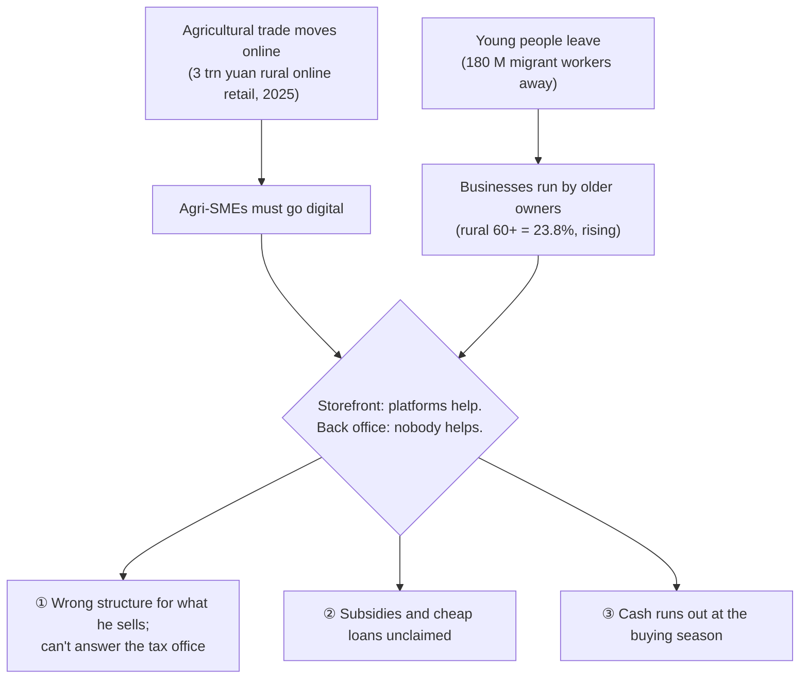
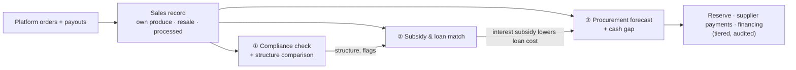
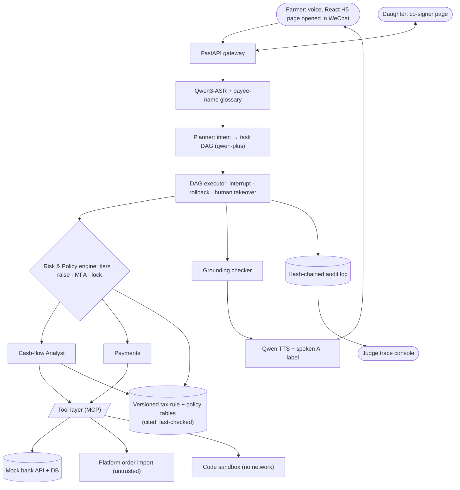
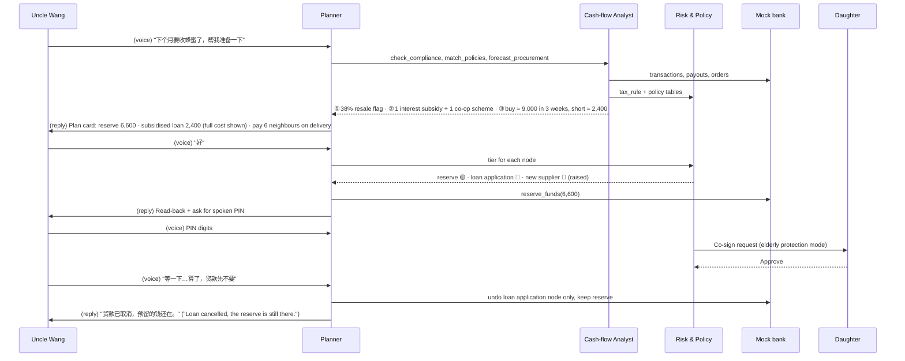
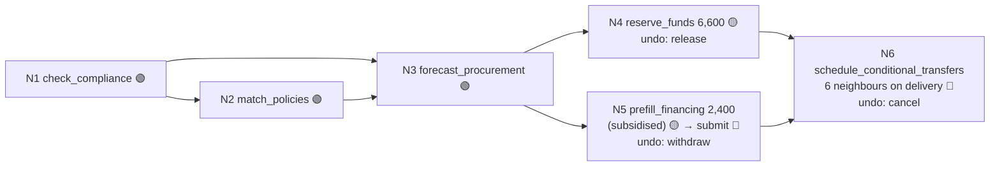

# We-Agri-Copilot 元农民 — Full Project Report (v3)
*A voice-first banking agent that does the back office for agri-SMEs moving online, built for the owners who can't do it alone: tax structure and compliance, subsidies, and cash for the next buying season.*
*WeBank Banking AI Agent challenge · Topic E, SME Finance Copilot · scenarios S2 + S1 + S6 · v3.1, 2026-10-15 (agri-SME reframe). v2.3 (one farmer's cash runway + sales record) is superseded.*

> [!summary] In one paragraph
> Agricultural trade in China is moving online: rural online retail passed **3 trillion yuan** in 2025 and online sales of agricultural products reached **783.31 bn yuan (+9.9%)**, through **20 M** rural online sellers. Agri-SMEs (family farms, small processors, resellers, cooperatives) have to make that move too. But the people who could run it have left: **180 M** migrant workers work away from home, and **23.81%** of the rural population is 60+, about 8 points above the cities and heading for 37.7% by 2035. A third of farm operators are 55+, and 43% have primary schooling or less. Older owners can sell on a phone with help; what they can't do is the **back office**.
>
> **We-Agri-Copilot** is a voice banking agent that does that back office for any agri-SME selling online. It is **designed for the owner least able to do it alone**: older, low-literacy, speaks rather than types. If it works for him, it works for every owner. Three features:
> 1. **Tax structure comparison + compliance check.** From his real sales record: is he set up correctly for what he sells (own produce vs resale), and what would each structure mean, with his own numbers. Cited information, never a recommendation, never filing.
> 2. **Grant & subsidy matching.** Which subsidies, interest-subsidised loans and bank agri-products he may qualify for, with a document checklist and a pre-filled bank application.
> 3. **Pre-procurement prediction.** What he'll need to buy next and when, whether the cash will be there, and a safe plan: reserve, supplier payments, financing.
>
> The three chain into one request ("下个月要收蜂蜜了，帮我准备一下", "Next month I'm buying honey, get me ready"), which is the S6 orchestration demo. Every action passes the brief's 🟢🟡🔴 tiers, raised automatically for a vulnerable user, and is written to a tamper-evident audit log.

Legend: **[verified]** = checked against an official or primary source (linked); **[calc]** = arithmetic on verified figures; **[recall]** = needs checking; **[unverified]** = no source yet; **[inference]** = our synthesis, label it as such.

---

## 1. Background: China, with research data

### 1.1 Agriculture is going online
| Indicator | Figure | Status |
|---|---|---|
| Rural online retail sales, 2025 | **3 trillion yuan** (+6.7%), first time above 3 trillion | [verified] [MOFCOM via Yicai](https://www.yicai.com/news/103041230.html) |
| Online retail sales of agricultural products, 2025 | **783.31 bn yuan (+9.9%)** | [verified] (same); MARA confirms 783.3 bn [Xinhua 2026-09-29](https://www.news.cn/fortune/20260929/24eb9e68c4304c9c9eb2a85c431e0d37/c.html) |
| Rural online sellers, end-2025 | **20.07 M** (+4.6%), of which 7.48 M livestream or social | [verified] [CCTV via Guangming](https://m.gmw.cn/2026-02/05/content_1304333360.htm) |
| Farm-help livestreams on head platforms, 2025 | > 4 M; farm specialty orders > 10 bn; > 20 M parcels a day | [verified] (same) |

### 1.2 The people who could run that transition have left
| Indicator | Figure | Status |
|---|---|---|
| Rural people aged 60+ (2020 census) | **120 M+ = 23.81%** of the rural population, ≈ 8 pts above urban. Younger people leave for work; retired migrant workers return. | [verified] [China Daily](https://www.chinaservicesinfo.com/s/202407/10/WS669ca75f498ed2d7b7eb39ab/guideline-promotes-rural-elderly-care.html) |
| Trend of the rural 60+ share | 10.89% (2000) → 23.81% (2020) → **37.7% projected for 2035** | [verified, as cited] [SUFE journal](https://qks.shufe.edu.cn/J/PDFFullDown/e3e72b2c-2f1f-431a-8885-8a17f5602348) |
| Migrant workers working away from home, 2025 | **180.06 M**; share of all migrant workers over 50 rose from 27.3% (2021) to 32% | [verified] [NBS via Yicai](https://www.yicai.com/news/103162204.html), [Economic Daily](https://finance.eastmoney.com/a/202605083730536683.html) |
| Agricultural operators aged 55+ (2016 census, latest) | **33.6%** of 314 M | [verified] [NBS](https://www.stats.gov.cn/sj/tjgb/nypcgb/qgnypcgb/202302/t20230206_1902105.html) |
| Operators with primary schooling or none (2016) | **43.4%** (6.4% none + 37.0% primary) | [verified] (same) / sum [calc] |
| People aged 60+ still working (2020) | ≈ 25%; > 28% of farm workers are 60+ | [verified] [Yicai Global](https://www2.yicaiglobal.com/news/a-quarter-of-china-elderly-are-still-working-most-as-farmers) |
| Rural digital-skills shortage | > 2 M, partly because young talent is hard to attract and keep | [verified, secondary citation of a MARA survey] [农家致富顾问 2025.1](https://yhyl.scbt.edu.cn/upload/33/cms/content/editor/1762100450659.pdf) |

> [!note] Inference (label it on slides)
> No national dataset gives the age of agri-SME owners. "The rural workforce behind agri-SMEs is ageing" is our synthesis of the rows above. Don't write "X% of agri-SMEs are run by elderly owners". See Agri-SME digital gap.

### 1.3 They can use a phone; they can't do the back office
| Indicator | Figure | Status |
|---|---|---|
| Rural internet penetration, Dec 2025 | **69.5%** | [verified] [CNNIC 57th via gov.cn](https://www.gov.cn/lianbo/202602/content_7057188.htm) |
| Internet use among people aged 60+, Dec 2025 | **53.7%** | [verified] (same) |
| Why non-users stay offline (CNNIC, 2020) | 51.5% don't understand computers or the internet; 21.9% are limited by education (e.g. pinyin) | [verified] [China News](https://www.chinanews.com/sh/2021/02-03/9403342.shtml) |
| Bank branches that stopped operating, 2025 | **> 9,900**, ≈ 84% rural-oriented; ATMs down > 250,000 in five years | [verified] / share [calc] [Securities Times via Xinhua](https://www.news.cn/20251223/7b66afdcd8b94782b38e4c0a04909815/c.html) |
| Basic banking done online | **> 90%** | [verified] [China Securities Journal](https://www.cs.com.cn/yh/04/202601/t20260113_6532923.html) |

### 1.4 The back office: the rules an agri-SME must get right
**Tax (feature ①).**
| Rule | What it says | Status |
|---|---|---|
| Platform reporting | Since **2025-06-23**, all internet platforms report each seller's identity and income to the tax authority **every quarter**; no small-income threshold, no farmer carve-out. Mismatches trigger a text asking the seller to check and explain. | [verified] [State Council](https://www.gov.cn/zhengce/content/202506/content_7029052.htm), [Xinhua 2026-07-30](https://www.news.cn/fortune/20260730/2b0aafc160a0436785ba6633f0f5273e/c.html) |
| VAT Law (in force 2026-01-01) | Art. 24(1): **farmers' own produce is VAT-exempt**; resold produce is not. Simplified levy rate 3%; small-scale = annual sales ≤ 5 M. | [verified] [VAT Law full text](https://www.news.cn/politics/20241225/e5586c597a974426a3a09094d8d24613/c.html) |
| Small-scale relief, 2026–2027 | Periodic filers with monthly sales ≤ 100,000 yuan exempt; 3% reduced to 1%; per-occasion filers' threshold 1,000 yuan per occasion/day | [verified] [KPMG on MOF/SAT 2026 No.10](https://kpmg.com/cn/zh/insights/2026/02/china-tax-alert-03.html) |
| 个体工商户 income tax | Halved on annual taxable income ≤ 2 M, to 2027-12-31 | [verified] [People's Daily](https://paper.people.com.cn/rmrbhwb/html/2023-08/04/content_26009328.htm) |
| Small low-profit enterprises | 25% of taxable income at 20% (≈ 5% effective), to 2027-12-31 | [verified] [SAT](https://fgk.chinatax.gov.cn/zcfgk/c102416/c5210453/content.html) |
| Enterprise income tax, agriculture | Growing, livestock and primary processing exempt; tea/flowers/aquaculture halved; **pure trading of bought-in produce not exempt** | [verified] [Jiangsu Tax Bureau](https://jiangsu.chinatax.gov.cn/art/2024/3/11/art_9674_239042.html) |
| Cooperatives | Members' own produce sold by the co-op treated as self-produced (VAT-exempt) | [verified, Caishui [2008] No.81]; continuity under the 2026 law [recall] |

**Subsidies (feature ②).**
| Fact | Status |
|---|---|
| Support is provincial/county-specific and set yearly. Example: Sichuan's 2026 plan subsidises loan interest for eligible agricultural operators (working-capital loans capped at 1 M yuan per project), criteria in each year's guide. | [verified] [Xinhua Finance 2026-08-13](https://www.cnfin.com/hb-lb/detail/20260813/4454740_1.html) |
| Farmers miss support they're owed: a Gansu farmer got no cultivated-land protection subsidy for 2017–2024 and only learned it existed in 2025; villagers gave conflicting accounts of the rules. | [verified, single case] [Yicai 2026-06-05](https://www.yicai.com/news/103218018.html) |
| National agricultural credit guarantee (农担) totals | [unverified]; no number on slides |

**Cash (feature ③).**
| Indicator | Figure | Status |
|---|---|---|
| Average resident pension | ≈ **246 yuan/month ≈ 8 yuan/day**; 2026 floor 163 yuan | [verified] / per-day [calc] [Yicai 2026](https://www.yicai.com/news/103086113.html) |
| Bank-tax interaction loans to tax-compliant small firms, 2025 | Nearly **3 trillion yuan**: good records unlock formal credit | [verified] [Xinhua](https://www.news.cn/fortune/20260128/7959f4bd5d3f464c85ffb9624a95855a/c.html) |

### 1.5 Why it matters to a bank (ESG framing)
- **S, social: inclusive finance** for the rural micro-businesses least served by app banking (§1.3). WeBank reports 6.5 M visits by elderly and disabled customers in 2025 and 7.6 M+ SME loan applicants (WeBank hackathon brief).
- **G, governance:** every action tiered, approved and hash-chain logged; tax and policy rules versioned with citations.
- **Business:** compliant records and matched subsidies make these customers **creditworthy**, so the bank can lend to them.
- **E, environmental:** not claimed. See ESG framing.

### 1.6 Who we serve: whole market and first users
| | Who | Evidence | Status |
|---|---|---|---|
| **Whole market** | Every agri-SME selling online: family farms, small processors, resellers, cooperatives | **20.07 M** rural online sellers, end-2025 (§1.1) | [verified] |
| **First users (beachhead)** | Older, low-literacy owners who can sell on a phone but can't run the back office | 33.6% of farm operators 55+; 43.4% primary schooling or less (§1.2); 51.5% of non-users don't understand the internet (§1.3) | [verified] rows; "agri-SME owners are ageing" is [inference] |
| **Demo persona** | Uncle Wang, Wang Family Apiary | Illustrative composite | n/a |

**Design principle: build for the hardest user.** The three features are not age-specific: any agri-SME selling online faces platform reporting, county subsidies and seasonal buying. Age and literacy decide *how* we deliver them (voice, read-back, tier raising, co-signer), not *who* may use them. One persona and one build; no separate flow for younger owners.

**Slide wording:** "agri-SMEs moving online, built for owners who can't do the back office alone". Never "X% of agri-SMEs are run by elderly owners" (§1.2 note, §7 #10).

---

## 2. The problem and the research behind it

### 2.1 Problem statement

> [!danger] The problem in one paragraph
> Agriculture is selling online, so agri-SMEs have to go digital. The young people who could run that have moved to the cities, and the businesses left in the villages are increasingly run by older owners. Platforms teach them to **list and livestream**. Nobody does their **back office**: whether the business is set up correctly for the tax office now that every platform reports sales, which subsidies and cheap loans it qualifies for, and whether the cash will be there when the next buying or planting season comes. Getting any one wrong costs money: an audit and fees, support left unclaimed, or informal borrowing at the worst time.

#### Pain ①: set up wrong for what he actually sells
| What is happening | Evidence | How it hurts |
|---|---|---|
| Every platform reports his sales to the tax office each quarter | [verified] §1.4 | A mismatch brings a text asking him to explain. |
| Only **his own produce** is exempt; resold or bought-in produce is not | VAT Law Art. 24 [verified]; pure trading not EIT-exempt [verified] | Once he resells neighbours' honey, the "farmer selling own produce" assumption breaks. |
| The right structure depends on his mix (individual / 个体户 / co-op / company), and each has different VAT, income tax and paperwork | §1.4 [verified] | He doesn't know there's a choice, or which rules he is under. |
| If he can't explain a mismatch | Audit, back tax, 0.05%/day late fee, fines, credit penalty [verified, Tax Collection Law Art. 32/63] | A small or zero tax bill becomes an audit and a credit mark, which also blocks formal loans. |

#### Pain ②: support he's entitled to goes unclaimed
| What is happening | Evidence | How it hurts |
|---|---|---|
| Subsidies and interest subsidies are county-specific and change yearly | [verified] Sichuan 2026 | No one reads the application guides for him. |
| Farmers miss subsidies they're owed | [verified, single case] Gansu, 8 years unpaid | Free money and cheaper credit left on the table. |
| Some schemes need a cooperative or registered business | [recall/verified mix, see Grant matching] | His structure choice (pain ①) decides what he can claim. |

#### Pain ③: cash runs out at the buying season
| What is happening | Evidence | How it hurts |
|---|---|---|
| Income is seasonal; the big outflows (buying neighbours' honey, spring inputs) come in a block | Pension ≈ 8 yuan/day [verified/calc] | He finds out he's short when the neighbours want paying. |
| Banks show a balance, not the next purchase | (product gap) | No warning, so he borrows informally. |
| Formal credit needs records | Bank-tax loans ≈ 3 trn yuan in 2025 [verified] | Without the records from ① he can't use them. |

#### How the three connect
The same **sales record** feeds all three: ① checks it against his structure, ② uses it as his business profile, ③ uses it as sales history and as proof of income. A fix in ① (a compliant record, maybe a co-op) unlocks ② (schemes that need it), and ② makes ③ cheaper (interest subsidies on the season loan).

#### One season at Wang Family Apiary (illustrative composite, not a real case)
| When | What happens | Pain |
|---|---|---|
| March | Spring inputs and hive feed to buy. No one checks whether the cash will last. | ③ |
| June | Sells his own honey and 6 neighbours' honey on two platforms; nothing is written down. | ① |
| July | A genuine tax text: the platforms' figure doesn't match. He can't say how much was his own honey. | ① |
| August | Neighbours want paying for this year's honey: about 9,000 yuan. He's 2,400 short. The bank asks for proof of income; he has none. He borrows from a relative. A county interest subsidy he qualified for goes unused. | ③ + ② + ① |

**What we must deliver:**
1. **(①)** Check his set-up against what he really sells, and compare the structures with his own numbers. Information, cited, never a recommendation or filing.
2. **(②)** Find the subsidies, interest subsidies and bank agri-products he may qualify for; checklist + pre-filled bank application.
3. **(③)** Predict the next purchase and the cash gap; plan and execute reserve, supplier payments and financing safely.
4. **(Delivery)** All by voice, with tiers strong enough for a vulnerable user.

### 2.2 Why existing tools miss this group
- Platform seller back-ends show **their own** orders and teach selling; none separates own produce from resale or relates it to a business structure.
- Tax-office texts say *that* figures differ, not *why*, and not what structure fits.
- Subsidy information sits in county notices and yearly guides, in text, for people who read them.
- Bank apps show a balance, not the next purchase, and assume literacy and typing.
- Generic AI chat can answer, but can't **act safely** on an account.

### 2.3 What we corrected or cut during research
- **The tax premise** (see §1.4): own produce is largely exempt; the risk is structure and records, not a high rate. Never "逃税".
- **Scope v2 → v3** (2026-10-15 decision): v2 (one farmer's runway + sales record) was too small. v3 widens to agri-SMEs and brings back structure comparison and grants, **bounded**: cited information, prepare-don't-submit.
- **Scams** stay cut as a product pillar; security remains as built-in safe execution (§4).
- **The ageing claim** is now sourced (§1.2) and the one inference is labelled.
- **Pension figure:** ≈ 246 average, 163 floor (not "180").

---

## 3. The solution

### 3.1 Concept
**Thesis:** *"Agri-SMEs are going online, and nobody does their back office. We-Agri-Copilot does it by voice: checks their set-up, finds their support, and has the cash ready for the next season. Built for the owner least able to do it alone, so it works for every owner. Every bank action executed safely."*

| # | Feature | What the user says | Topic E capability | Scenario |
|---|---|---|---|---|
| **①** | **Tax structure comparison**: compliance check on the sales record + structure table (individual / 个体户 / co-op / company) with his numbers; explains a tax text; **tax reserve**: sets aside a small share of each resale payout in a separate pot (🟡) | "我这样卖蜂蜜合规吗？" ("Is the way I sell honey OK?") / "这个税务短信什么意思？" | Business financial analysis | S2 |
| **②** | **Grant matching**: subsidies, interest subsidies, bank agri-products; checklist; pre-filled bank application | "有没有什么补贴我能申请？" ("Any subsidies I can apply for?") | Financing-option matching | S2 → S6 |
| **③** | **Pre-procurement forecast**: next purchases + cash gap + plan (reserve, supplier payments, financing) | "收蜂蜜的钱够不够？" ("Will I have enough to buy the honey?") | Cash-flow management and alerts | S2 + S1 |
| **Chain** | ①→②→③ in one request | "下个月要收蜂蜜了，帮我准备一下" | All three | **S6** |
| Safety | Permission tiers, tier raising, spoken PIN + co-signer | "给老李转800，蜂蜜钱" ("Pay Old Li 800 for honey") | (Security 30%) | S1 |

**Foundation:** the Tax-ready income statement (sales record) (sales record): platform orders from any platform matched to payouts into his bank account, each sale tagged own produce / resale / processed.

### 3.2 Architecture

**Key principles**
1. **LLMs plan and explain; tools compute.** Balances, forecasts, reconciliation, compliance checks, structure tables, policy matching and tier decisions are deterministic code.
2. **The policy engine, not the LLM, decides the tier** of every action.
3. **Platform data and notes are untrusted input.** They can never create a payee or raise an amount.
4. **Nothing external happens without the right approval**, and everything is audited.
5. **Rules are data, not prompts.** Tax rules and subsidy policies live in versioned tables with citations; the LLM can only quote them.

### 3.3 User flow (end to end): "Next month I'm buying honey, get me ready"

**The task DAG for this request**

Partial rollback is a feature: he can cancel one branch (the loan) and keep the rest.

### 3.4 The four roles and what each does
| Role | Responsible for | Key tools | Was (v1) |
|---|---|---|---|
| Planner | Speech to text, vague or implicit intent, slot filling from history, **builds the task DAG**, one clarifying question at a time | `asr_transcribe`, `plan_dag` | Listener |
| Cash-flow Analyst | **Sales record** (orders from any platform matched to payouts, own/resale/processed tags). **①** compliance check + structure table. **②** profile → policy match → checklist, pre-filled bank application. **③** procurement forecast + cash gap + plan. Sandboxed open-ended questions. | `import_platform_orders`, `match_payouts`, `reconcile_income`, `check_compliance`, `compare_structures`, `match_policies`, `forecast_procurement`, `match_financing`, `run_sandboxed_query` | Ledger Keeper + Tax Shield + Underwriter |
| Payments | Supplier payments by name, phone or note; scheduled and conditional transfers ("pay on delivery"); season reserves; financing application submission; split bills | `resolve_payee`, `transfer`, `schedule_transfer`, `conditional_transfer`, `reserve_funds`, `submit_financing` | Broker (escrow removed) |
| Risk & Policy engine | Tiers and raising, MFA (spoken PIN + co-signer), injection filter, safety lock, audit chain; **owns the versioned tax-rule and policy tables** | `assign_tier`, `mfa_challenge`, `lock`, `audit_append`, `get_rules`, `get_policies` | Guard (anti-scam scoring removed) |

### 3.5 Orchestration framework
- **LangGraph state graph.** The Planner outputs a schema-validated DAG: `nodes[{id, tool, args, depends_on, undo, base_tier}]`. The executor runs it in order.
- **Interrupt:** `interrupt()` before any 🟡/🔴 node, and on "wait" or "stop". A checkpointer persists state, so the user can answer later.
- **Rollback:** saga pattern. Completed nodes run their `undo` in reverse order.
- **Human takeover:** "get me a person", or two failed clarifications, hands over the DAG, state and audit trail to a banker view.
- **Proactive triggers:** a daily procurement/cash check, an order-import job, a quarterly compliance check (after each platform reporting quarter) and a policy-deadline check enter the same graph, so alerts follow the same rules as replies.

---

## 4. Guardrails and security design

### 4.1 Permission tiers (brief §3.1), with tier raising for vulnerable users
| Tier | Policy (brief) | Our actions |
|---|---|---|
| 🟢 Green | Automatic | Balance, transactions, sales record, compliance check, structure comparison, policy matches, procurement forecast, financing comparison |
| 🟡 Yellow | User confirmation (spoken read-back + "对/好", "yes/OK") | Transfers ≤ 1,000/day cumulative to known payees, season reserves, the tax reserve rule, schedules, pre-filling a financing application, cancelling a schedule |
| 🔴 Red | Strong verification (multi-factor) | Transfers > 1,000/day, payments to a **new supplier**, submitting a financing application, unlocking the safety lock |

**Tier raising** (Permission tiers). The policy engine may raise a tier but never lower it:
- a new payee raises 🟡 to 🔴;
- an amount more than 2× the usual transfer, or more than 50% of the balance, raises 🟡 to 🔴;
- a night-time transfer raises 🟡 to 🔴;
- with **elderly protection mode** on, 🔴 also needs the co-signer.

**Strong verification for a user who can't type:**
- the bound device (possession);
- a spoken 6-digit PIN, where the digits are checked, not the voice (knowledge);
- the family co-signer (an extra factor).

Voiceprint is **never** a factor, because voice cloning needs only seconds of audio [verified].

### 4.2 Security mechanisms (brief §3.2)
| Requirement | Implementation |
|---|---|
| No hallucinated results or account info | **Grounding checker:** every number and name in a reply must match a tool output from the same turn, otherwise the reply is blocked and regenerated. Account data comes only from the bank API. |
| Prompt-injection defence | Platform order notes, payee notes and merchant names are wrapped as **untrusted data**. Each role has a tool allow-list. A qwen-flash classifier scores injection. Untrusted text can't add DAG nodes, payees or amounts. |
| Complete decision and execution logs | Append-only audit log: utterance → transcript → DAG → tier and reason → approval → API call → balance before/after. SHA-256 chained, with a verify script. |
| Safety lock | 3 failed PINs, **or** injection detected, **or** an anomaly score over the threshold locks 🟡/🔴 actions. 🟢 stays available. Unlock needs strong verification plus a human. |
| Sandboxed generated code | Open-ended analysis questions: the LLM writes pandas code, which runs in a container with `--network none --read-only`, CPU and memory caps and a 5-second timeout. Output is schema-checked and every run is logged. |

### 4.3 Per-role guardrails
| Role | Hard limits | Escalates when |
|---|---|---|
| Planner | Never executes; only proposes a DAG. Asks one clarifying question at a time. | Low ASR confidence; ambiguous numbers (十四/四十, "14"/"40") |
| Cash-flow Analyst | Read-only on accounts. Structure comparison is **information, not advice**: same table for every user, his numbers filled in, every cell cited, no "you should", no "tax-free", no filing. Policy matches say "may qualify". Forecasts state assumptions and a range. | Reconciliation gap above a threshold; a rule or policy past its last-checked date; stale data |
| Payments | Acts only on a DAG node approved by the policy engine. Payees come only from the bank's payee list or a confirmed new entry. | Payee unresolved or ambiguous |
| Risk & Policy | Can hold or lock, never send money. Cannot lower a tier. | Lock events; repeated failures |

### 4.4 Compliance by design (light touch)
- **AI labelling** (in force since 2025-09-01) [verified]: a spoken label at the start of each voice reply ("元农民助手：…", "Yuannongmin assistant: …") plus metadata.
- **Personal data:** ID and bank details are tokenised and never put in prompts. A consent screen covers voice and financial data. The demo uses synthetic persona data only.
- **Tax information:** the structure comparison is free, cited, identical in form for every user and never recommends; it refers the user to 12366 or the village office. This keeps it outside entrusted "tax professional services" (SAT Order 58) [verified]; a licensed partner would be needed for anything paid.
- **Subsidies:** "may qualify" wording; policy table entries carry citation and last-checked date; the demo county is labelled **simulated**; the agent never submits to government systems.
- **Financing:** mock-bank products only; full cost shown; no fees charged to the user.

---

## 5. UI/UX and tech stack

### 5.1 Interaction design (built for older, low-literacy owners)
- **Voice first:** push-to-talk, like a WeChat voice note. Every reply is spoken **and** shown as a large-font card.
- **Read-back before any 🟡/🔴 action:** "Pay Old Li 200 yuan for feed, right?"
- **One alert, one suggested action.** No dashboards for the farmer.
- **Plan card** for multi-step requests: steps coloured by tier with live status (pending, done, undone).
- **Comparison card** for ①: four columns (A–D), his numbers in each, a citation icon per cell, and a fixed footer "这是信息，不是建议 · 请咨询12366" ("Information, not advice · ask 12366").
- **Support card** for ②: one row per match, "may qualify", documents needed, deadline, where to go.
- **Co-signer page** on the daughter's phone: the request, its reason, approve or decline.
- **Judge trace console:** transcript → DAG → tier and reason → API calls → grounding result → audit hash.

### 5.2 Tech stack
| Layer | Hackathon build | Production path |
|---|---|---|
| Channel | **React + Vite + Tailwind** mobile web page, opened inside WeChat by link or QR | Verified WeChat service account or Mini Program |
| Backend | Python **FastAPI** | Same, on a mainland cloud |
| Agent | **LangGraph** (state graph, `interrupt()`, SQLite checkpointer) + MCP tool layer | Same |
| Bank | **Mock core-banking API** (accounts, payees, transfers, schedules, reserves, financing products, MFA, lock) + **rule tables** (tax rules, county policies; cited, versioned) | Bank's real APIs + a bank-maintained policy table |
| Data | **SQLite** (`bank_*`, `rule_*` and `agent_*` tables); 12 months of synthetic Wang Family Apiary data | Bank-grade database |
| Sandbox | Docker, no network, read-only | Same, hardened |
| Deploy | Docker Compose on one VM + HTTPS | n/a |

---

## 6. The AI models used, and why
| Role | Model (Alibaba Cloud Model Studio, Singapore region) | Why |
|---|---|---|
| Speech to text | **qwen3-asr-flash** with a payee-name glossary as context | Covers Mandarin plus Sichuanese, Minnan, Wu and Cantonese. On dialect and elderly speech it far outperforms Whisper: character error rate 5.10 vs 28.79 on KeSpeech, 3.81 vs 10.61 on Elders & Kids [verified, Qwen3-ASR report]. |
| Planner and explanations | **qwen-plus** | Strong Chinese, function calling, JSON output; allowed by the organiser |
| Intent and injection classifier | **qwen-flash** | Fast, cheap second opinion |
| Text to speech | **Qwen TTS** | Natural Mandarin with dialect options; the AI label is added to every clip |

**Why not Claude or Groq (the original plan):** Claude isn't available in mainland China [verified], and the organiser allows Qwen. All agents work through tools and typed state, so the model is a configuration choice, not an architectural one.

---

## 7. Open questions and risks: research and prevention
| # | Question or risk | What research found | Status | Prevention |
|---|---|---|---|---|
| 1 | Pension figure | Average ≈ 246, floor 163 (2026) | ✅ | Use these two numbers only |
| 2 | 66% / 28% / 46% | 28% verified; 46% and ≈ 2/3 calculated from the census | ✅ | Say "about two-thirds" |
| 3 | Income-tax treatment of own produce | VAT exemption verified; income tax [recall] | 🟡 | Statement says "own produce / resale", never "tax-free" |
| 4 | Is raw bottled honey a primary agricultural product? | Not verified | 🟡 | Keep the label "own produce"; no exemption claim |
| 5 | Platform order data format | No real API for an unregistered shop; formats differ by platform | ✅ known | Mock CSVs in 2 platform styles (marketplace + livestream shop), matched to payouts in the mock bank account |
| 6 | Dialect speech recognition | Qwen3-ASR far better than Whisper | ✅ | Demo in Mandarin; read-back catches errors |
| 7 | Model availability | Claude unavailable in China; Qwen allowed | ✅ | Qwen throughout |
| 8 | Scope creep | Scope cut on 2026-10-15 | ✅ | Feature-freeze on 14 Nov (Build Plan) |
| 9 | Do mock financing products using income records reflect reality? | Bank-tax loans and record-based sole-proprietor loans exist [verified]; WeBank's own criteria unknown | 🟡 | Label the products as mock; describe eligibility as "uses verified income history" without claiming WeBank rules |
| 10 | "Agri-SMEs are run by elderly owners" | No direct dataset; rural ageing, migration and operator age are verified | 🟡 inference | Say "the rural workforce behind agri-SMEs is ageing"; label as inference |
| 11 | Cooperative VAT treatment under the 2026 VAT Law | Law exempts own produce [verified]; continuity of Caishui [2008] No.81 [recall] | 🟡 | Cell shows [recall] + "check with 12366" until verified |
| 12 | Subsidy data source | Policies are county-specific [verified]; no national machine-readable catalogue found | 🟡 | One simulated county table, cited; roadmap: bank-maintained table |
| 13 | Scope grew back (3 features) | v3 adds two features with 5 weeks left | 🟠 | Cut line on 7 Nov: grants become a static match list without pre-fill (Build Plan §11) |

## 8. Further risks that research must prove or rule out
1. **Sales-record accuracy** 🟠. *Prove:* across 2 platforms, orders are matched to bank payouts and the totals agree with the platforms' figures on 3 seeded datasets with deliberate gaps (resale, refunds, a missed payout).
2. **Forecast usefulness** 🟠. *Prove:* see item 9.
3. **Planner reliability** 🟠. *Prove:* 30 phrasings of the 3 scenarios, measuring the share that produce a valid DAG without clarification. Target ≥ 90%, with a fixed fallback plan.
4. **Injection resistance** 🟠. *Prove:* 30 malicious order notes and payee notes, measuring the catch rate and zero unauthorised actions.
5. **Usability with elderly users** 🟡. *Prove:* a 5-person test with elderly relatives, measuring task success and the read-back correction rate.
6. **Tax-information framing** 🟠. *Prove:* a check with someone in accounting or tax that the structure table and compliance flags read as information, not advice; adjust wording.
7. **Structure-table correctness** 🟠. *Prove:* every cell traced to a cited rule; 3 synthetic sales mixes (all own produce / 40% resale / processed) give the expected flags.
8. **Policy matching** 🟡. *Prove:* 10 synthetic profiles against the simulated county table; zero matches without every eligibility rule satisfied.
9. **Procurement forecast usefulness** 🟠. *Prove:* backtest on 3–5 synthetic agri-SME households; report the warning lead time and amount error.
10. **Production path** 🟡 (roadmap only): data residency, AI-service registration and real bank APIs.

---

*Related:* Build Plan (how we build and submit it)
*This is design research for a hackathon, not legal or tax advice.*
